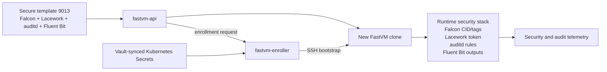

# FastVM — Rapid VM Provisioning for Proxmox

Spin up isolated VMs on Proxmox in seconds using linked clones. Designed for AI agent sandboxes, dev environments, and ephemeral workloads.

## Architecture

```
┌─────────────────┐         ┌──────────────────────────────────────────┐
│   API Client    │  HTTP   │          Proxmox Host                    │
│  (agent/curl)   │────────▶│  ┌─────────────┐    ┌────────────────┐  │
│                 │         │  │ fastvm-api   │───▶│ fastvm (bash)  │  │
└─────────────────┘         │  │ :8090        │    │ linked clones  │  │
                            │  └──────┬───────┘    │ networking     │  │
                            │         │            │ cloud-init     │  │
                            │         ▼            └────────────────┘  │
                            │  /var/lib/fastvm/                        │
                            │  ├── vms.json        ┌────────────────┐  │
                            │  └── users.json      │ Proxmox/QEMU   │  │
                            │                      │ VMs (60000+)   │  │
                            └──────────────────────┴────────────────┘  │
                                                                       │
Each user gets an isolated /26 network:                                │
  192.168.X.Y/26 ─── Linux bridge ─── dnsmasq ─── NAT ─── Internet   │
```

## How It Works

1. **Linked clones** from a packer-built template (Ubuntu 24.04) — creation takes ~5s per VM
2. **Isolated networking** — each user gets their own /26 subnet with a dedicated Linux bridge, dnsmasq DNS relay, and iptables NAT
3. **Static IPs** via cloud-init — IPs are deterministic based on username hash, no DHCP race conditions
4. **State files** in `/var/lib/fastvm/*.json` — the API reads these directly for fast list/status responses

## Backend Flavors

FastVM currently supports two server-side backend flavors:

- **Proxmox FastVM** through `fastvm-api` on a Proxmox host.
- **Firecracker microVMs** through `fastvm-api` on a Firecracker-enabled host,
  using the host-local Rust `firecrackerctl` helper internally.

The same `fastvm` client binary works with both. Point `FASTVM_API` at the
desired API host; backend choice is configured server-side with
`FASTVM_BACKEND=proxmox` or `FASTVM_BACKEND=firecracker`. Firecracker is the
default when `FASTVM_BACKEND` is unset.

CPU sizing is backend-specific:

- Firecracker follows the upstream Firecracker machine-config API and supports
  at most 32 vCPUs per microVM. Use it for fast lifecycle workflows and
  scale-out across multiple small VMs.
- Proxmox is the backend for one large compile VM, including 64-120+ core
  requests. FastVM caps Proxmox virtio NIC queues at 64 while preserving the
  requested VM core count.

See [docs/backend-flavors.md](docs/backend-flavors.md) for how to choose and
switch between the two flavors.

On the Firecracker backend you can also freeze a **running** VM into a warm
template and restore clones in ~0.6 s with no guest boot — see
[docs/warm-snapshots.md](docs/warm-snapshots.md).

## Security

FastVM images are expected to use the secure baseline template `9013` unless a
user intentionally selects a custom template that was derived from a secure
base. The secure baseline includes the VM security stack expected by Telnyx
infrastructure:

- CrowdStrike Falcon sensor for endpoint detection and response.
- Lacework agent for workload security monitoring.
- `auditd` for Linux audit events.
- Fluent Bit for forwarding audit and system logs.



Security tooling is split between image-time packages and clone-time
enrollment:

- The packages, services, and baseline configuration are baked into the
  Proxmox or Firecracker template.
- Per-clone identity, customer IDs, access tokens, tags, and other secrets are
  not baked into reusable templates.
- `fastvm-enroller` reads Vault-synced Kubernetes Secrets and pushes the
  per-clone security/bootstrap configuration into each new VM over the FastVM
  SSH proxy.
- `fastvm-api` can run enrollment in `async` mode, `required` mode, or with
  enrollment disabled when `FASTVM_ENROLLER_URL` is unset.

Custom templates must preserve the security baseline. FastVM snapshots are
allowed only when the source VM was created from a registered security template
such as `9013`; insecure bases are rejected so they cannot become shared
templates. Do not bake host-specific secrets, enrolled Falcon/Lacework identity,
SSH host keys, or one-time bootstrap tokens into snapshots.

## API Reference

All endpoints return JSON:
```json
{"ok": true, "data": { ... }, "error": null}
```

### Health Check

```bash
GET /api/v1/health
```
Returns service status and the running version.
```bash
curl http://HOST:8090/api/v1/health
# {"ok":true,"data":{"status":"ok","version":"v1.4.0"}}
```

### Version

```bash
GET /api/v1/version
```
Returns the running binary version. Useful for verifying a deploy succeeded or detecting a rollback.
```bash
curl http://HOST:8090/api/v1/version
# {"ok":true,"data":{"version":"v1.4.0"}}
```

If the version doesn't match your latest release tag, the release was likely rolled back due to a failed health check.

### Status

```bash
GET /api/v1/status
```
Returns total VMs, user count, per-user breakdown with networks.
```bash
curl http://HOST:8090/api/v1/status
```

### Create VMs

```bash
POST /api/v1/vms
```
```json
{
  "user": "agent-42",
  "count": 3,
  "template": 9011,
  "memory": 4096,
  "cores": 2,
  "ssh_key": "/path/to/key.pub"
}
```
Only `user` and `count` are required. Returns VM details with deterministic IPs immediately.

```bash
curl -X POST http://HOST:8090/api/v1/vms \
  -H 'Content-Type: application/json' \
  -d '{"user": "sandbox", "count": 2}'
```

### List VMs

```bash
GET /api/v1/vms
GET /api/v1/vms?user=sandbox
```
```bash
curl http://HOST:8090/api/v1/vms
curl http://HOST:8090/api/v1/vms?user=sandbox
```

### Get Single VM

```bash
GET /api/v1/vms/:vmid
```
```bash
curl http://HOST:8090/api/v1/vms/60001
```

### Destroy Single VM

```bash
DELETE /api/v1/vms/:vmid
```
```bash
curl -X DELETE http://HOST:8090/api/v1/vms/60001
```
Returns once destruction is queued and the VM is removed from FastVM state.
Backend cleanup continues asynchronously when required, for example while
Proxmox purges disks.

### Destroy All User VMs

```bash
DELETE /api/v1/users/:user/vms
```
Queues destruction for all VMs and cleans up FastVM state/networking for the
user. Backend cleanup continues asynchronously when required.
```bash
curl -X DELETE http://HOST:8090/api/v1/users/sandbox/vms
```

### Converge

Keep one VM, destroy all others for a user. Useful for "competition" patterns where multiple VMs race and the winner survives.

```bash
POST /api/v1/converge
```
```json
{
  "user": "compete",
  "keep_vmid": "60005"
}
```
```bash
curl -X POST http://HOST:8090/api/v1/converge \
  -H 'Content-Type: application/json' \
  -d '{"user": "compete", "keep_vmid": "60005"}'
```

## Setup

### Prerequisites

For Proxmox:

- Proxmox VE 8.x host
- A packer-built VM template (built-in default VMID: 9012, override with `FASTVM_DEFAULT_TEMPLATE`)
- `qemu-guest-agent` in the template image

For Firecracker:

- Firecracker-enabled Linux host
- `/opt/fastvm-microvm` populated with `bin/firecrackerctl`, kernels, SSH key, and rootfs templates
- NVMe-backed XFS storage with reflink enabled mounted at `/opt/fastvm-microvm` for fast CoW clones
- Maximum 32 vCPUs per microVM. This is an upstream Firecracker API limit, so
  use Proxmox for a single 64-120+ core VM or split work across multiple
  Firecracker VMs.
- Falcon sensor installed into base templates with `scripts/firecracker/fc-install-falcon-template.sh`; the enroller applies the per-clone CID/tags after VM creation
- Security baseline template `9013` created with `scripts/firecracker/fc-create-security-template.sh` when clones should include Falcon, Lacework, auditd, and Fluent Bit

Verify Firecracker clone storage on the host:

```bash
sudo /opt/fastvm-microvm/bin/firecrackerctl storage-info --install-dir /opt/fastvm-microvm
```

Expected output includes `STORAGE_FSTYPE=xfs`, `REFLINK_SUPPORTED=1`, and
`ROOTFS_CLONE_METHOD=reflink`.

### Install

```bash
# On the backend host
sudo cp fastvm-api /usr/local/bin/
sudo chmod +x /usr/local/bin/fastvm-api

# Create state directory
sudo mkdir -p /var/lib/fastvm
```

### Run

```bash
# Direct (defaults to Firecracker if FASTVM_BACKEND is unset)
sudo fastvm-api --port 8090

# Proxmox backend
sudo FASTVM_BACKEND=proxmox fastvm-api --port 8090

# With systemd (recommended)
sudo systemctl start fastvm-api
```

### Configuration

The API server accepts these flags:

| Flag | Default | Description |
|------|---------|-------------|
| `--port` | `8090` | HTTP listen port |
| `--backend` | `firecracker` | Backend implementation: `proxmox` or `firecracker` |
| `--state-dir` | `/var/lib/fastvm` | Path to state directory |
| `--firecracker-install-dir` | `/opt/fastvm-microvm` | Firecracker install directory |
| `--firecracker-template` | `9013` | Default Firecracker rootfs template |

Environment:

| Variable | Default | Description |
|----------|---------|-------------|
| `FASTVM_BACKEND` | `firecracker` | Backend implementation: `proxmox` or `firecracker` |
| `FASTVM_DEFAULT_TEMPLATE` | `9012` | Proxmox template VMID used when clients omit `template` |
| `FASTVM_FIRECRACKER_INSTALL_DIR` | `/opt/fastvm-microvm` | Firecracker install directory |
| `FASTVM_FIRECRACKER_DEFAULT_TEMPLATE` | `9013` | Default Firecracker rootfs template |
| `FASTVM_FIRECRACKER_SSH_USER` | `root` | Firecracker guest SSH user returned in API responses |
| `FASTVM_ENROLLER_URL` | unset | Optional FastVM enrollment service URL; unset disables enrollment |
| `FASTVM_ENROLLER_MODE` | `async` when URL is set | Enrollment mode: `disabled`, `async`, or `required` |
| `FASTVM_ENROLLER_TOKEN` | unset | Bearer token used by `fastvm-api` when calling the enroller |
| `FASTVM_ENROLLER_TOKEN_FILE` | unset | File containing the bearer token; preferred for mounted secrets |
| `FASTVM_ENROLLER_LACEWORK_TOKEN_FILE` | unset | File containing the Lacework `agent_access_token` synced from the existing role Vault path |
| `FASTVM_ENROLLER_CROWDSTRIKE_CUSTOMER_ID_FILE` | unset | File containing the Falcon `crowdstrike_customer_id` synced from the existing role Vault path |
| `FASTVM_ENROLLER_FEATURES` | service default | Comma-separated enrollment feature list |
| `FASTVM_ENROLLER_TIMEOUT` | `2m` | Per-VM enrollment timeout |

### Enrollment Service

`cmd/fastvm-enroller` is a Kubernetes-friendly service that reads Vault-synced
Kubernetes Secrets and pushes rendered security/bootstrap config into new VMs
over the FastVM SSH proxy. It keeps Vault credentials out of cloneable VM
templates.

Build it locally with:

```bash
make build-enroller
make build-enroller-image
```

Kustomize manifests live under `deployments/fastvm-enroller/k8s/`. See
[docs/fastvm-enrollment-service.md](docs/fastvm-enrollment-service.md) for the
Vault secret keys, API contract, and FastVM API integration settings. The AT1
deployment registers with Consul Connect as `fastvm-enroller`, so FastVM API
hosts should use `http://fastvm-enroller.query.prod.telnyx.io:8080`.

### Systemd Service

```ini
# /etc/systemd/system/fastvm-api.service
[Unit]
Description=FastVM API Server
After=network.target

[Service]
Type=simple
EnvironmentFile=-/etc/default/fastvm-api
ExecStart=/usr/local/bin/fastvm-api --port 8090
Restart=always
RestartSec=5
StandardOutput=journal
StandardError=journal

[Install]
WantedBy=multi-user.target
```

### Deploy from Dev Machine

```bash
# Set environment
export FASTVM_HOST=proxmox-host.example.com
export FASTVM_SSH_KEY=~/.ssh/id_rsa

# Build and deploy
make deploy
```

### Automated Deploys (Release Workflow)

Pushing a version tag triggers an automated build and release:

```bash
git tag v1.2.0
git push origin v1.2.0
```

**What happens:**

1. GitHub Actions builds the `fastvm-api-linux-amd64` binary
2. A GitHub Release is created with the binary attached
3. The Proxmox API host is updated through its self-update endpoint
4. The Firecracker API host is bootstrapped/updated over SSH, then health-checked

**Self-update endpoint:**

The API exposes `POST /api/v1/update` which downloads the latest release binary from GitHub and restarts itself via systemd. It is protected by a shared secret (`FASTVM_UPDATE_SECRET`).

```bash
# Trigger manually from a machine that can reach the host
curl -X POST -H "Authorization: Bearer $SECRET" http://HOST:8090/api/v1/update
```

**First-time host setup:**

```bash
make setup-host \
  DEPLOY_HOST=atl1-pc1-025 \
  DEPLOY_BACKEND=proxmox \
  UPDATE_SECRET=<secret> \
  GITHUB_TOKEN=<token>

make setup-host \
  DEPLOY_HOST=atl1-pc1-027.hosts.telnyx.io \
  DEPLOY_SSH_HOST=atl1-pc1-027.hosts.telnyx.io \
  UPDATE_SECRET=<secret>
```

This installs the systemd service and writes `/etc/default/fastvm-api` with backend settings and secrets. The `GITHUB_TOKEN` is needed only when using the self-update endpoint to download release assets from the private repo.

**Auto-rollback:**

After updating, the API performs a health check (up to 5 retries over 10s). If the new binary fails to respond on `/api/v1/health`, it automatically restores the previous binary and restarts.

You can also trigger a manual rollback:

```bash
curl -X POST -H "Authorization: Bearer $SECRET" http://HOST:8090/api/v1/rollback
```

**GitHub repo secrets/variables needed:**

| Name | Type | Purpose |
|------|------|---------|
| `FASTVM_UPDATE_SECRET` | Secret | Shared secret for the update/rollback endpoints |
| `FASTVM_PROXMOX_API_HOST` | Variable | Proxmox API URL. Defaults to `http://atl1-pc1-025.hosts.telnyx.io:8090` |
| Firecracker deploy targets | Workflow matrix | Deploys to `atl1-pc1-027.hosts.telnyx.io` and `atl1-pc1-026.hosts.telnyx.io` |
| `FASTVM_FIRECRACKER_DEPLOY_USER` | Variable | SSH user for Firecracker deploy. Defaults to `terraform` |
| `FASTVM_FIRECRACKER_DEPLOY_SSH_KEY` | Secret | Optional SSH private key for Firecracker deploy. The matching public key must be installed for the deploy user on each Firecracker host. |
| `FASTVM_FIRECRACKER_INSTALL_DIR` | Variable | Firecracker install directory on every Firecracker deploy target. Defaults to `/opt/fastvm-microvm` |
| `FASTVM_FIRECRACKER_DEFAULT_TEMPLATE` | Variable | Default Firecracker rootfs template on every Firecracker deploy target. Defaults to `9013` |
| `FASTVM_FIRECRACKER_SSH_USER` | Variable | Guest SSH user returned by every Firecracker API host. Defaults to `root` |
| `FASTVM_ENROLLER_URL` | Variable | Optional enroller service URL. Firecracker hosts leave enrollment disabled when unset |
| `FASTVM_ENROLLER_TOKEN` | Secret | Optional bearer token written to Firecracker API hosts so they can call `fastvm-enroller` |
| `FASTVM_ENROLLER_MODE` | Variable | Optional enrollment mode for Firecracker API hosts. Defaults to `async` when URL is set |
| `FASTVM_ENROLLER_FEATURES` | Variable | Optional comma-separated feature override |
| `FASTVM_ENROLLER_TIMEOUT` | Variable | Optional per-VM enrollment timeout |
| `FASTVM_RELEASE_GITHUB_TOKEN` | Secret | Optional long-lived token written to the Firecracker host for manual self-update from private releases |

## CLI Reference

Use the `fastvm` client against either backend by setting `FASTVM_API`:

```bash
fastvm create -c 3 -u myuser                    # Create 3 VMs
fastvm create -c 1 -u test -m 8192 --cores 4    # Beefy VM
fastvm list                                       # List all VMs
fastvm list -u myuser                             # Filter by user
fastvm ssh 60001                                  # SSH into VM
fastvm destroy -u myuser                          # Destroy all user VMs
fastvm destroy --vm 60001                         # Destroy single VM
fastvm converge -u myuser --keep 60001            # Keep winner, destroy rest
fastvm status                                     # Overview
```

## Network Layout

Each user gets a deterministic /26 block from the 192.168.0.0/16 supernet:

```
User "agent-1" → block 847 → 192.168.211.192/26
  Gateway:  192.168.211.193  (on Linux bridge fvm-XXXXXX)
  VM #1:    192.168.211.194
  VM #2:    192.168.211.195
  ...up to 61 VMs per user
```

The block is derived from an MD5 hash of the username, ensuring the same user always gets the same network.

## License

Internal — Telnyx
